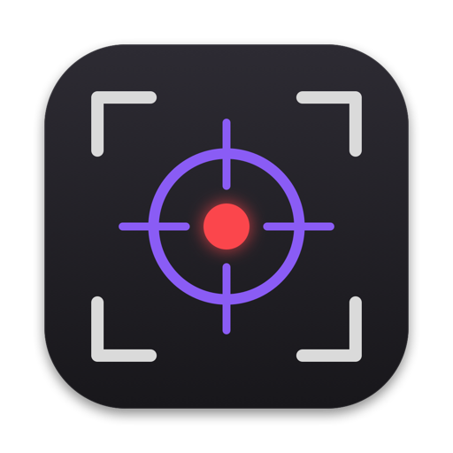

<p align="center"></p>

<h1 align="center">VidSniper</h1>
<p align="center">Record part of your screen, trim it, and drop the video anywhere</p>

A small native macOS app to share a quick screen recording without going through the Finder.

- **Record**: press ⇧⌘8, select an area (or the whole screen), and record with system audio and your microphone.
- **Edit**: cut, balance the audio, highlight clicks, add annotations.
- **Share**: a light MP4 is ready in the background, to drag or copy (⌘C) anywhere.

Requires **macOS 15 (Sequoia)** or later.

## Install

There are two ways to install VidSniper.

### Option 1: Homebrew (recommended)

```sh
brew tap elliot67/vidsniper https://github.com/Elliot67/VidSniper
brew install --cask vidsniper
```

Updates: `brew upgrade --cask vidsniper`.

### Option 2: Download

1. Download `VidSniper-<version>.zip` from the [latest release](https://github.com/Elliot67/VidSniper/releases/latest).
2. Unzip it and move `VidSniper.app` to **Applications**.
3. The app isn't notarized, so macOS blocks the first launch. Either:
   - open **System Settings > Privacy & Security** and click **Open Anyway**,
   - or run `xattr -dr com.apple.quarantine /Applications/VidSniper.app`.

### First launch

Allow **Screen Recording**, and the **Microphone** if you want your voice in the video.

> **Disclaimer**: this app was vibe coded with an AI assistant. It's still a real, working app, used daily and covered by automated tests.